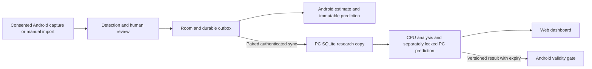

# Target architecture (planned)

T002 implements `contracts/v1/` and the Python reference validator in `backend/greedycat/contracts.py`. T003 adds the local FastAPI health/device service, fixed loopback launcher and typed diagnostic OpenAPI. Gameplay storage, synchronization, Android, web and intelligence components below remain planned. The repository started empty; both directives are preserved in this monorepo.

## Components and boundaries

- `android/`: Kotlin/Compose, Room, structured coroutines. Begin with one app module and packages for domain, database, capture, vision, statistics, connectivity and features. Split Gradle modules only when useful. Essential ingestion, history and lightweight statistics work without PC access.
- `backend/`: Python, typed FastAPI service, SQLite research copy and bounded worker queue. Separate device diagnostics, synchronization, probability estimation, evaluation, model registry and resources. FastAPI is the intended choice pending dependency compatibility checks.
- `web/`: React/TypeScript/Vite client of the backend API. Empty states are real; no simulated telemetry disguised as live data. Every shipped control calls a working backend operation.
- `contracts/`: versioned schemas and shared valid/invalid fixtures; Android and Python validate the same invariants.
- `tools/`: Windows setup, read-only device diagnostics, startup and verification. Raw local research data stays outside Git.

## Integrity and lifecycle

Model entities: CaptureSession, Round, RoundSnapshot, Observation, Outcome, Wager, Prediction, ModelVersion, Evaluation, Correction. Use stable UUID identifiers, UTC timestamps, source evidence hashes and explicit real/synthetic provenance. Round natural uniqueness includes game installation/context, mode and round number, with reset scope pending U06; never deduplicate across uncertain contexts silently.

An observation retains raw detection, confidence, coordinates, frame/time and review status. Final outcomes require reliable evidence or human confirmation. Corrections append original/replacement/reason/actor/time; verified data cannot be downgraded by OCR. SQLite/Room transactions enforce invariants; migrations and backups have restoration tests.

Round states: UNKNOWN, BETTING_OPEN, BETTING_CLOSED, SPINNING, RESULT_PENDING, RESULT_CONFIRMED, ROUND_COMPLETED. Keep screen identity (rules, history, opening, mode tabs, popup) separate from round lifecycle. Missing frames cause uncertainty/recovery, never invented transitions or outcomes. Review temporal evidence before confirmation.

## Contract and transport plan

Initial event envelope: schema_version, event_id, device_id (local pseudonym), capture_session_id, context_id, round_id, mode, sequence, device_timestamp, phase, data_quality, payload and evidence references. Prediction adds source, model_version, probabilities, dataset cutoff, issued_at, intended_round, expires_at, uncertainty, abstention reason and evidence-of-skill state.

`GET /api/v1/health`, `GET /api/v1/devices` and `GET /api/v1/openapi.json` are implemented by T003. `/events`, `/rounds`, `/predictions`, `/models` and `/jobs` under `/api/v1` remain proposed; absent routes return 404. Add only those with a working task implementation. Ingestion will use idempotency keys, transactional acknowledgments and a durable Android outbox. Same ID/different payload is a conflict. Reconnect retries must be bounded and retry-safe; human corrections will use revisions and explicit conflict review.

Start desktop service bound to loopback. Add short-lived explicit pairing, revocable per-device credentials, authenticated encrypted transport and certificate trust before LAN binding. Manual address first; mDNS is an enhancement. Secrets never appear in logs or Git. ADB USB development is optional and cannot silently authorize navigation or capture. Web authentication, allowed origins and request protection must be tested before controls are exposed.

Estimate clock offsets and uncertainty, measure round-trip latency, and reject expired/wrong-round results. Preserve local predictions and PC predictions separately. Never replace a locked prediction. A learned result cannot be used to create a retrospective prediction. Persist dataset cutoff and deadline; late observations cannot enter pre-result features.

## Models, decisions and resources

Frequency and regularized Dirichlet baselines precede feature models. Probability, uncertainty, data quality, calibration and demonstrated skill are separate outputs. Empty history abstains; no proven edge remains explicit until chronological evidence justifies it. Simulation datasets never merge into actual history. Decision calculations require a verified full payout matrix and support no wager.

Start single-worker CPU operation on the audited 8 GB machine. Implement configurable Eco/Balanced/Performance budgets, backpressure, cancellation and idle throttling; benchmark before enabling acceleration. Phone-only, phone+PC and PC-only research modes share contracts and preserve data during disconnection. Atomic model installation checks checksum, compatibility, validation evidence and rollback path.
