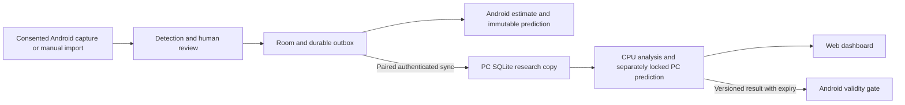

# Target architecture (planned)

T002 implements `contracts/v1/` and the Python reference validator. T003 adds the local FastAPI health/device service and fixed loopback launcher. T004 implements the React diagnostic dashboard, served by FastAPI from `web/dist/` on the same guarded origin, with bounded opt-in polling and runtime response checks. T005 adds the standalone Android foundation with transactional draft storage. T006 adds offline reference import and human outcome review. T007 adds local statistical summaries and immutable prospective abstention checkpoints. Synchronization, verified live acquisition and demonstrated predictive skill remain planned/unverified. The repository started empty; both directives are preserved in this monorepo.

## Components and boundaries

- `android/`: implemented single Kotlin/Compose app module with domain/data/ui/ingestion packages, lifecycle-aware coroutines and Room. Overview/history/settings, reference import/manual review and an explicit separate demo workspace operate offline. Real history starts empty. Capture, statistics and connectivity are future packages; split Gradle modules only when useful.
- `backend/`: Python, typed FastAPI service, SQLite research copy and bounded worker queue. Separate device diagnostics, synchronization, probability estimation, evaluation, model registry and resources. FastAPI is the intended choice pending dependency compatibility checks.
- `web/`: implemented React/TypeScript/Vite client of health/device APIs, with overview/device views, selection, manual refresh and optional visible-page polling. Build/watch emits static files served by the backend; there is no second dev HTTP server. Other dashboards remain planned. Every shipped control has working behavior; no simulated telemetry appears in production.
- `contracts/`: versioned schemas and shared valid/invalid fixtures. Python implements v1 structural/semantic validation; Android T005 checks draft invariants and one shared synthetic fixture. Full Android wire-contract conformance is pending.
- `tools/`: Windows setup, read-only device diagnostics, startup and verification. Raw local research data stays outside Git.

## Integrity and lifecycle

T005 stores sessions, draft rounds and missing-field rows in Room schema v2. Composite foreign keys bind session/context/mode/provenance, and nullable round-number uniqueness is scoped by context/mode. Inserts compare existing content and reject conflicts transactionally. Separate real/demo database files and repository provenance checks isolate synthetic samples. A tested 1->2 migration adds persistent display preferences without discarding v1 records; both schemas are tracked. There is no destructive migration fallback. T005 did not implement outcomes, prediction locking, corrections or durable outbox storage.

T006 extends to schema v3 through an explicit 2->3 migration. Reference originals are hashed private files, separated by provenance; imports never enumerate user storage. Metadata records actual byte size, detected MIME, import time and video duration. Human review explicitly supplies observed time and video position, never inferred from import time. Confirmation verifies evidence bytes and appends a review. Corrections append a new revision with the expected predecessor, reviewer pseudonym and reason; the original pending draft and all prior reviews remain unchanged. History derives human confirmation from the latest revision. A persisted context scopes natural round uniqueness; changing context is explicit. T006 did not include full wire export, authenticated identity/clocks, outcome training selection, prediction locks or synchronization.

T007 schema v4 persists immutable local ANDROID checkpoint rows with frozen dataset JSON and SHA-256, model/dataset identity, cutoffs, issue/expiry times and abstention reason. SQL triggers reject update/delete. Snapshot selection uses review revisions known strictly before the cutoff and isolates context/mode/provenance; evidence is rehashed within 1,000-row/256-MiB bounds. Symmetric Dirichlet research means/SD and empirical frequencies are conditional descriptive calculations, not measured game skill. Manual targets are unverified and always abstain; current production code issues no live probability forecasts. New targets cannot reuse known historical rounds. UTC/elapsed-realtime consistency and deadline checks are local guards, not trusted clocks. Later outcomes/corrections affect later snapshots only. Demo round clearing retains the ledger; explicit future retention is T019. Full prediction wire export and authenticated PC predictions remain future work.

Model entities: CaptureSession, Round, RoundSnapshot, Observation, Outcome, Wager, Prediction, ModelVersion, Evaluation, Correction. Use stable UUID identifiers, UTC timestamps, source evidence hashes and explicit real/synthetic provenance. Round natural uniqueness includes game installation/context, mode and round number, with reset scope pending U06; never deduplicate across uncertain contexts silently.

An observation retains raw detection, confidence, coordinates, frame/time and review status. Final outcomes require reliable evidence or human confirmation. Corrections append original/replacement/reason/actor/time; verified data cannot be downgraded by OCR. SQLite/Room transactions enforce invariants; migrations and backups have restoration tests.

Round states: UNKNOWN, BETTING_OPEN, BETTING_CLOSED, SPINNING, RESULT_PENDING, RESULT_CONFIRMED, ROUND_COMPLETED. Keep screen identity (rules, history, opening, mode tabs, popup) separate from round lifecycle. Missing frames cause uncertainty/recovery, never invented transitions or outcomes. Review temporal evidence before confirmation.

## Contract and transport plan

Initial event envelope: schema_version, event_id, device_id (local pseudonym), capture_session_id, context_id, round_id, mode, sequence, device_timestamp, phase, data_quality, payload and evidence references. Prediction adds source, model_version, probabilities, dataset cutoff, issued_at, intended_round, expires_at, uncertainty, abstention reason and evidence-of-skill state.

`GET /api/v1/health`, `GET /api/v1/devices` and `GET /api/v1/openapi.json` are implemented by T003. `/events`, `/rounds`, `/predictions`, `/models` and `/jobs` under `/api/v1` remain proposed; absent routes return 404. Add only those with a working task implementation. Ingestion will use idempotency keys, transactional acknowledgments and a durable Android outbox. Same ID/different payload is a conflict. Reconnect retries must be bounded and retry-safe; human corrections will use revisions and explicit conflict review.

Start desktop service bound to loopback. Add short-lived explicit pairing, revocable per-device credentials, authenticated encrypted transport and certificate trust before LAN binding. Manual address first; mDNS is an enhancement. Secrets never appear in logs or Git. ADB USB development is optional and cannot silently authorize navigation or capture. Web authentication, allowed origins and request protection must be tested before controls are exposed.

T008 supplies a separate `pairing-1` HTTPS service and Android manual-address client. An operator-confirmed self-signed leaf SHA-256 anchors trust; validity/self-signature/server-auth and default IP/hostname checks run before credentials. Native requests are bounded, use TLS 1.2/1.3, disable redirects/proxies and run only on explicit actions. Android stores its bearer credential with Keystore AES-GCM in noBackupFilesDir; the PC stores only digests in a bounded SQLite ledger. Pairing/revocation do not transfer gameplay data. PC startup remains loopback by default; a private-IP listener requires an explicit LAN flag, RFC1918 bind, matching certificate and exact Host/native-origin guards. The diagnostic dashboard stays on loopback HTTP. See the T008b report for measured transport acceptance and remaining renewal/network limitations.

Estimate clock offsets and uncertainty, measure round-trip latency, and reject expired/wrong-round results. Preserve local predictions and PC predictions separately. Never replace a locked prediction. A learned result cannot be used to create a retrospective prediction. Persist dataset cutoff and deadline; late observations cannot enter pre-result features.

## Models, decisions and resources

Frequency and regularized Dirichlet baselines precede feature models. Probability, uncertainty, data quality, calibration and demonstrated skill are separate outputs. Empty history abstains; no proven edge remains explicit until chronological evidence justifies it. Simulation datasets never merge into actual history. Decision calculations require a verified full payout matrix and support no wager.

Start single-worker CPU operation on the audited 8 GB machine. Implement configurable Eco/Balanced/Performance budgets, backpressure, cancellation and idle throttling; benchmark before enabling acceleration. Phone-only, phone+PC and PC-only research modes share contracts and preserve data during disconnection. Atomic model installation checks checksum, compatibility, validation evidence and rollback path.
